# Homeworld 架构可视化图

本文档包含 Homeworld 游戏系统的各种架构图表，使用 Mermaid 格式编写。

---

## 1. 系统架构总览

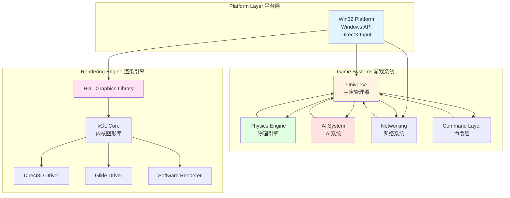

---

## 2. 游戏主循环

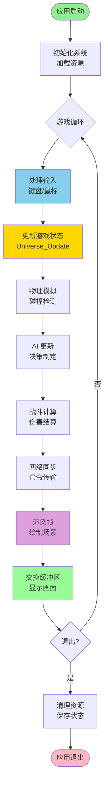

---

## 3. AI 系统层次结构

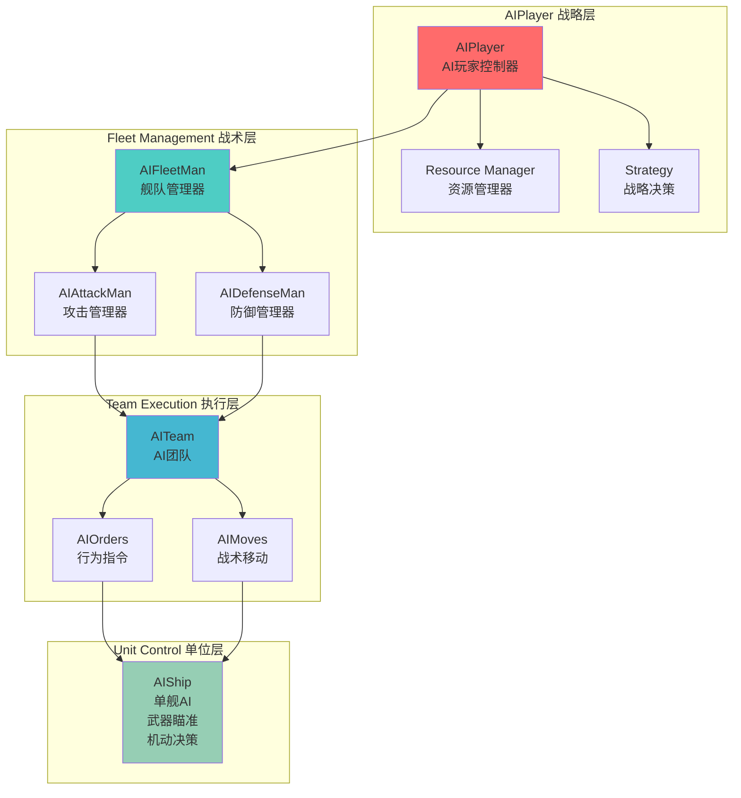

---

## 4. 渲染管线

```mermaid
flowchart LR
    Input[顶点数据<br/>Vertex Data] --> Trans[顶点变换<br/>ModelView Matrix]

    Trans --> Light[光照计算<br/>Lighting]
    Light --> Proj[投影变换<br/>Projection Matrix]

    Proj --> Clip[裁剪<br/>Clipping]
    Clip --> Persp[透视除法<br/>Perspective Divide]

    Persp --> View[视口变换<br/>Viewport Transform]

    View --> Rast[光栅化<br/>Rasterization]

    Rast --> Pixel[像素处理<br/>Pixel Operations]
    Pixel --> Depth[深度测试<br/>Depth Test]
    Depth --> Alpha[Alpha混合<br/>Blending]
    Alpha --> Frame[写入帧缓冲<br/>FrameBuffer]

    style Input fill:#E8F5E9
    style Trans fill:#C8E6C9
    style Light fill:#A5D6A7
    style Rast fill:#81C784
    style Frame fill:#66BB6A
```

---

## 5. 网络同步架构

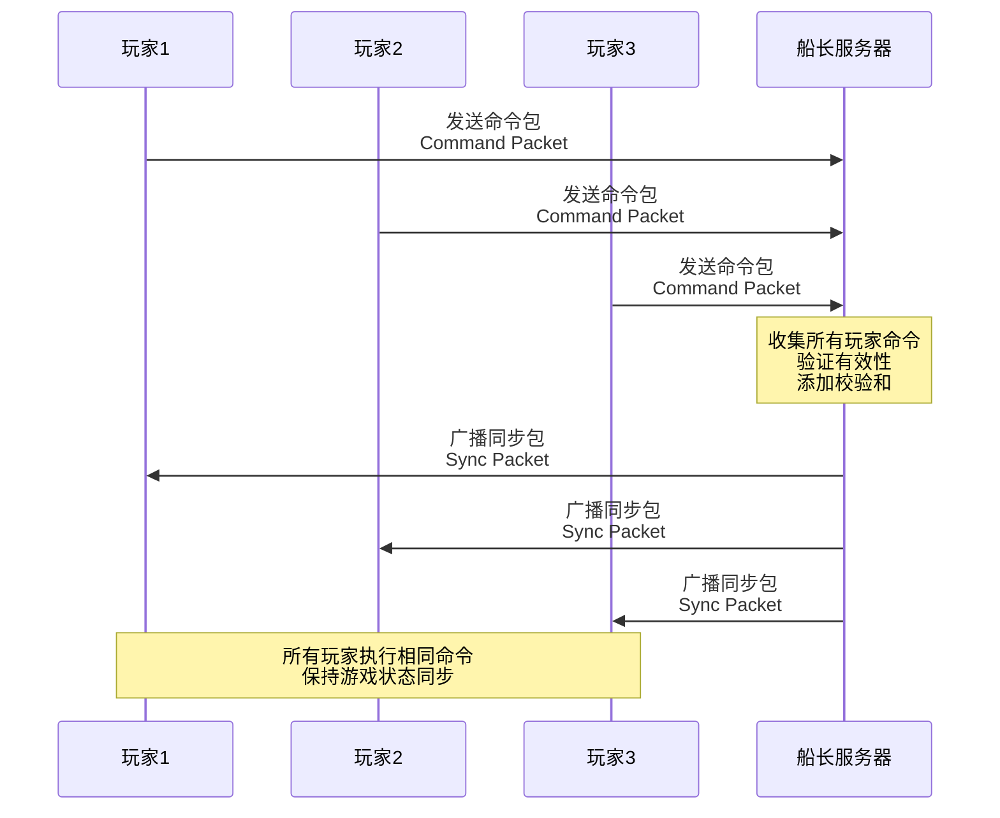

---

## 6. 对象生命周期

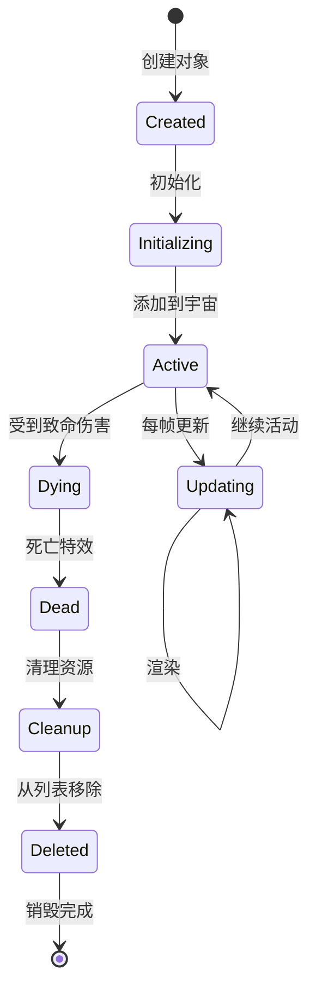

---

## 7. 命令处理流程

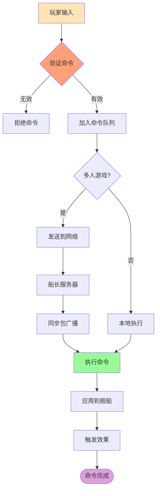

---

## 8. 碰撞检测流程

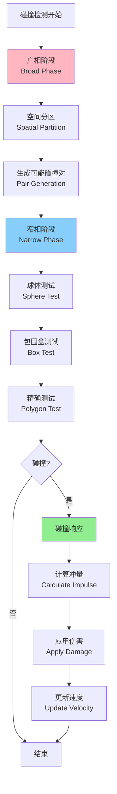

---

## 9. 资源管理系统

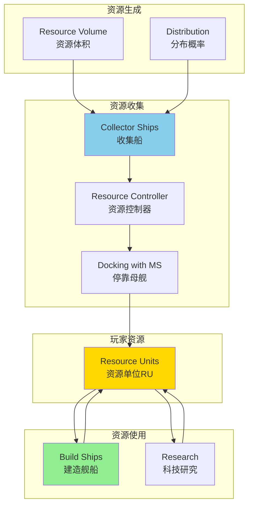

---

## 10. 依赖关系图

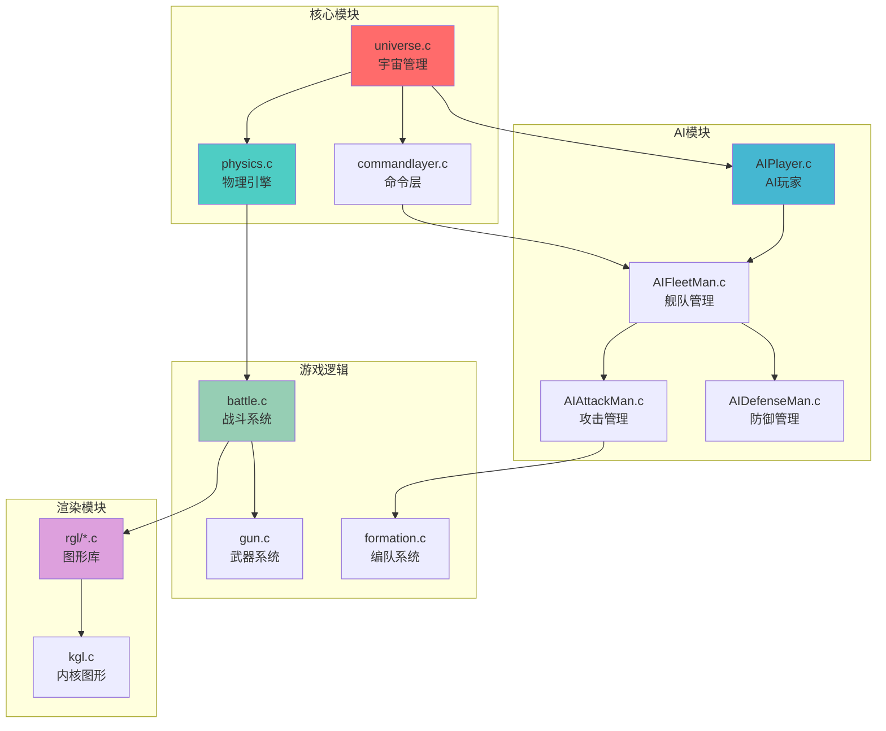

---

## 11. 文件系统架构

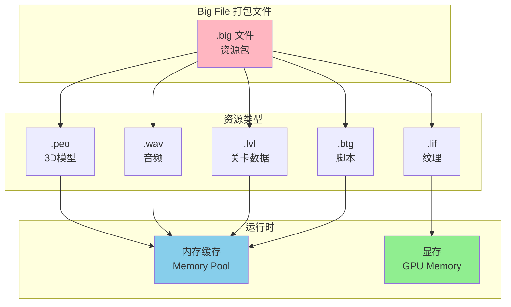

---

## 12. 多人游戏状态机

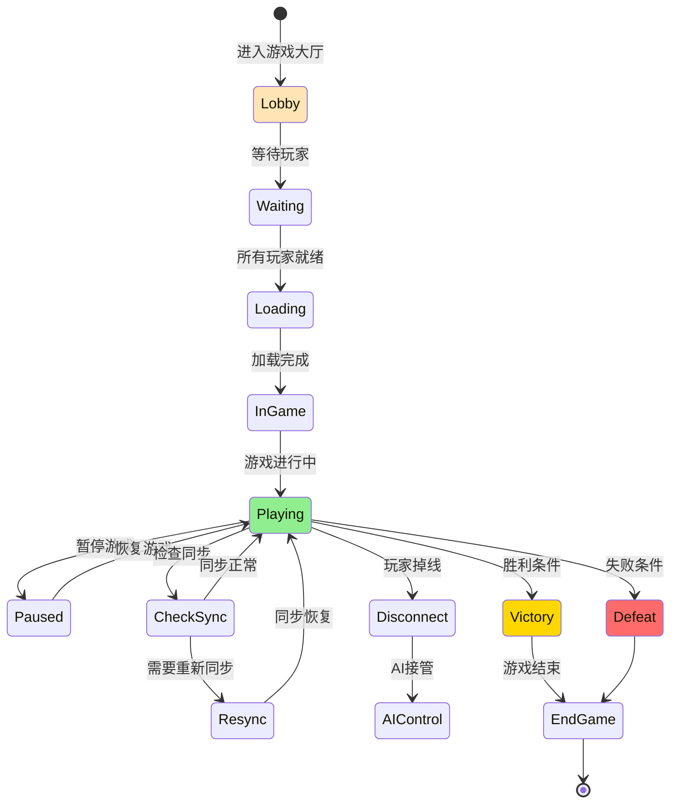

---

## 图例说明

- **方框** 表示系统/模块
- **圆角框** 表示开始/结束状态
- **菱形** 表示决策点
- **箭头** 表示数据流或控制流
- **不同颜色** 表示不同类型的系统或状态

---

*注：这些图表使用 Mermaid 格式编写，可在支持 Mermaid 的 Markdown 查看器中渲染。*

*文档生成日期: 2026-01-08*
